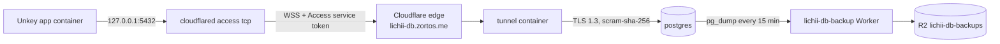

# Lichii PostgreSQL host

This directory runs the Lichii database on a single Docker host: PostgreSQL 18, plus a Cloudflare Tunnel connector that is its only way in. The production host is a Raspberry Pi 5 at `/opt/lichii-db`.



## Security model

- No host port is published. Postgres listens only on the `db` Docker network, and the tunnel container is the only other member.
- `lichii-db.zortos.me` is behind Cloudflare Access with a single service-token policy. Without the token, the edge refuses the WebSocket.
- `pg_hba.conf` accepts only `hostssl` from the Docker network, for the `lichii` and `lichii_unkey` roles, with `scram-sha-256`. TLS 1.3 is the minimum.
- The server certificate (`CN=db.lichii.internal`) is signed by a private CA that `setup` creates. The app pins that CA through `DATABASE_SSL_CA` and checks the name through `DATABASE_SSL_SERVERNAME=db.lichii.internal`.
- `lichii` owns the schema and is not a superuser. `lichii_unkey` has only `SELECT/INSERT/UPDATE/DELETE` and `CONNECT`, with a connection limit of 16 (`sql/roles.sql`).
- The backup Worker accepts only a bearer token whose SHA-256 it stores. It can list, read and create objects, but it can't overwrite or delete them. The R2 lifecycle rules handle expiry.

## Install

1. Copy this directory to `/opt/lichii-db`, owned by root.
2. Write the tunnel token to `state/secrets/tunnel_token`. Write the backup Worker URL to `state/backup_url`. Write the bearer token to `state/secrets/backup_token`, and an `Authorization: Bearer <token>` line to `state/secrets/backup_auth_header`.
3. Run `sudo /opt/lichii-db/bin/lichii-db setup`. It generates the passwords and certificates on first run, starts the stack, applies the roles, and installs the backup timers. It is safe to rerun.

Setup writes the app's connection string to `state/secrets/app_database_url` and the owner's to `state/secrets/owner_database_url`. Both point at `127.0.0.1:5432`, where the app's sidecar listens.

## Operations

| Task | Command |
| --- | --- |
| Back up now | `sudo lichii-db backup manual <name>` |
| Prove the newest backup restores | `sudo lichii-db restore-check` |
| Restore a given object and compare it with a fingerprint | `sudo lichii-db restore-check manual/<name>.dump state/migration/<run>/source.txt` |
| Copy a database in, with a write freeze on the source | `sudo lichii-db migrate <source.env> <source-ca.pem> [--replace]` |
| Archive another database to `manual/` and prove its restore | `sudo lichii-db archive <source.env> <source-ca.pem> <name>` |
| SQL shell | `sudo lichii-db psql` |

Timers: a `frequent/` dump every 15 minutes, kept for 3 days. A `daily/` dump at 00:05 UTC, kept for 35 days. A restore check at 03:30 UTC. `manual/` objects never expire.

`migrate` freezes every source table except `rate_limits` with statement triggers (`sql/freeze.sql`), so reads keep working and writes fail. It then fingerprints the source, dumps it, uploads the dump to `manual/`, and restores it as `lichii`. Finally it removes the freeze from the copy, reapplies the grants, and fails unless the target's fingerprint (`sql/fingerprint.sql`) matches the source's.

## Schema migrations

The app's DML-only role can't run DDL. Apply a new migration as the owner before you deploy. Use any machine with `cloudflared access tcp --hostname lichii-db.zortos.me --url 127.0.0.1:15432` and the service token:

```sh
DATABASE_URL=<owner URL, port 15432> DATABASE_SSL_CA="$(cat ca.crt)" DATABASE_SSL_SERVERNAME=db.lichii.internal npm run db:prepare
```
